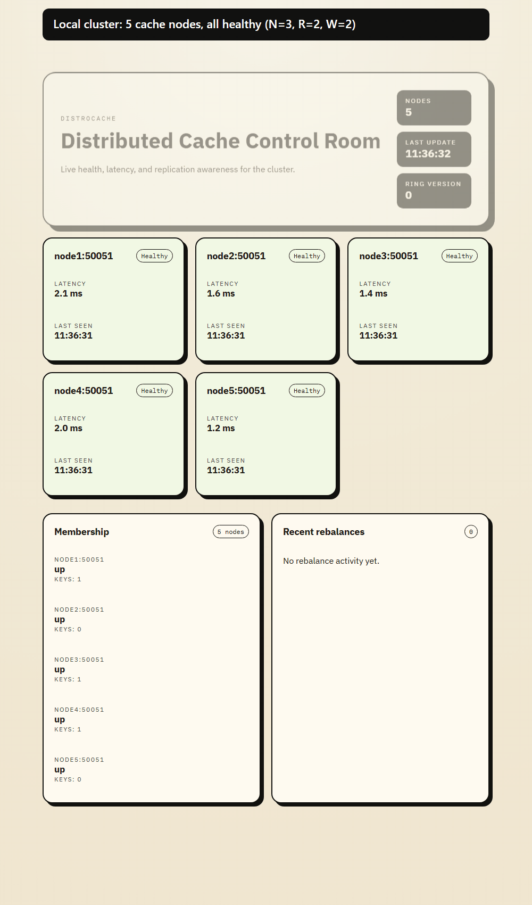
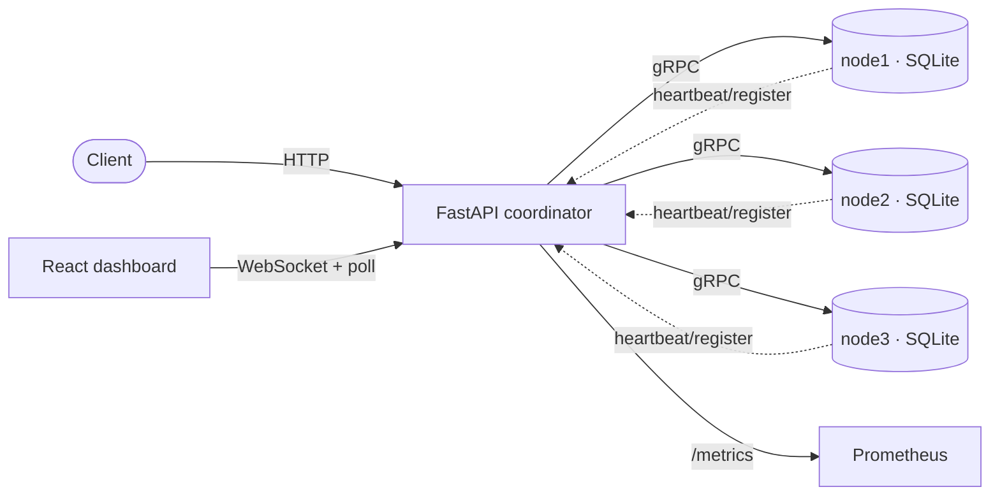
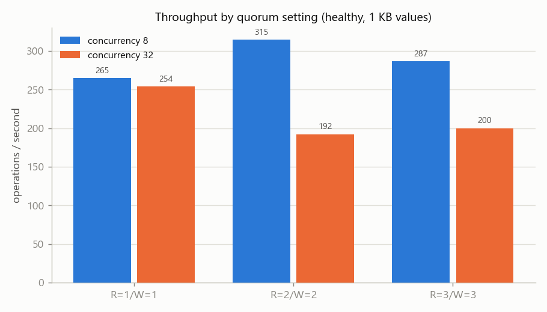
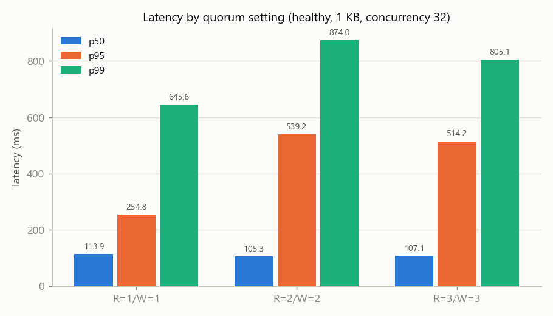
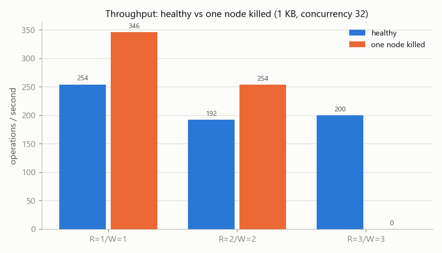

# DistroCache

[](https://github.com/theshloksschauhan/DistroCache/actions/workflows/ci.yml)

DistroCache is a Dynamo-style distributed key-value cache: a FastAPI **coordinator** routes every
request through a consistent-hash ring to replicated gRPC **storage nodes** (each backed by its own
SQLite file), with tunable **N/R/W quorums**, **hybrid-logical-clock** versioning and last-writer-
wins, **tombstones** for deletes, **read repair**, and **safe rebalance** when the ring changes. With
`R + W > N` it gives read-your-writes for acknowledged writes; it ships with a real-process
integration harness, a Jepsen-style consistency checker, and benchmarks.

## Demo



The recording is the real five-node cluster from `docker compose up --build`, captured from the dashboard once a second ([MP4](docs/demo/distrocache-demo.mp4)).
It writes and reads `greeting`, crashes node3 with `docker compose kill node3` (the read still returns 200 from the surviving replicas), then restarts node3 and shows it rejoin and report a rebalance.
Reproduce it locally with `docker compose up --build -d`, then `python scripts/record_demo.py` (needs Playwright and ffmpeg), then `docker compose down`.

The hosted dashboard at [distrocache-frontend.vercel.app](https://distrocache-frontend.vercel.app) has no cluster attached and shows no nodes: the cache nodes are long-running gRPC servers, which Vercel cannot host.

## Architecture



The coordinator holds no key data — it mints versions, enforces quorums, and runs read repair and
the health/membership loops. Each node is a cache over SQLite (WAL), refilled from replicas on a
schema change. Full walkthrough with request lifecycles and diagrams:
[docs/ARCHITECTURE.md](docs/ARCHITECTURE.md).

## Quick start

### Docker

```bash
docker compose up --build
```

- API: http://localhost:8000 · Dashboard: http://localhost:3000 · Prometheus: http://localhost:9090

```bash
curl -X POST localhost:8000/kv/greeting -H 'Content-Type: application/json' -d '{"value":"hello"}'
curl localhost:8000/kv/greeting      # {"key":"greeting","value":"hello","node":"...","acks":2,"version":{...}}
curl -X DELETE localhost:8000/kv/greeting
```

### Local (from the repo root)

Install dev dependencies: `pip install -r requirements-dev.txt`.

**Start the coordinator** (two nodes, N=2):

PowerShell
```powershell
$env:NODE_ADDRESSES="127.0.0.1:50051,127.0.0.1:50052"; $env:REPLICATION_FACTOR="2"
python -m uvicorn backend.app:app --reload
```
bash
```bash
export NODE_ADDRESSES=127.0.0.1:50051,127.0.0.1:50052 REPLICATION_FACTOR=2
python -m uvicorn backend.app:app --reload
```

**Start a node** (one terminal per node; change id/port/address/storage each time):

PowerShell
```powershell
$env:NODE_ID="node1"; $env:GRPC_PORT="50051"; $env:NODE_ADDRESS="127.0.0.1:50051"
$env:BACKEND_URL="http://127.0.0.1:8000"; $env:REPLICATION_FACTOR="2"; $env:STORAGE_PATH="node1.db"
python -m node.app
```
bash
```bash
export NODE_ID=node1 GRPC_PORT=50051 NODE_ADDRESS=127.0.0.1:50051 \
  BACKEND_URL=http://127.0.0.1:8000 REPLICATION_FACTOR=2 STORAGE_PATH=node1.db
python -m node.app
```

**Frontend**: `cd frontend && npm ci && npm run dev`.

**See it survive a crash** (starts its own cluster, kills a node under load, heals, rebalances):
```bash
python scripts/demo.py
```

## API

| Method & path | Body | Success | Failure |
|---|---|---|---|
| `POST /kv/{key}` | `{"value": "...", "ttl_seconds"?: int}` | `200 {key, replicas, acks, version}` once `W` ack | `503 {acks, required, errors}` below `W`; `400` missing value |
| `GET /kv/{key}` | — | `200 {key, value, node, acks, version}` (highest of `R`) | `404` miss or winning tombstone; `503` fewer than `R` respond |
| `DELETE /kv/{key}` | — | `200 {key, replicas, acks, version}` (versioned tombstone) | `503` below `W` |
| `GET /health` · `GET /membership/nodes` · `GET /metrics` | — | cluster/membership/Prometheus views | — |
| `POST /membership/register` · `/heartbeat` · `/deregister` · `/rebalance` | node metadata | ring updates | `400` missing fields |
| `WS /ws/cluster` | — | live cluster snapshots | — |

A `version` is `{physical_ms, logical, coordinator_id}` (the HLC tuple).

## Configuration

Coordinator (most used):

| Var | Meaning |
|---|---|
| `NODE_ADDRESSES` | comma-separated seed gRPC node addresses |
| `REPLICATION_FACTOR` (N) | replicas per key (default 3) |
| `READ_QUORUM` (R) / `WRITE_QUORUM` (W) | responses/acks required (default 2 each; `1 ≤ R,W ≤ N`; `R+W>N` gives read-your-writes) |
| `READ_REPAIR_ENABLED` | repair stale replicas after a read (default `true`) |
| `TTL_SECONDS` | default key lifetime; 0 disables (a request may override per write) |
| `HEARTBEAT_TIMEOUT` / `DEAD_TIMEOUT` | liveness grace / ring-removal grace (default 6 / 30 s) |
| `REQUEST_TIMEOUT` / `RETRY_ATTEMPTS` / `RETRY_BACKOFF` | per-replica gRPC call tuning |
| `COORDINATOR_ID` | identity mixed into every version (keep unique per coordinator) |

Node: `BACKEND_URL`, `NODE_ID`, `GRPC_HOST`/`GRPC_PORT`, `NODE_ADDRESS`, `STORAGE_PATH`,
`REPLICATION_FACTOR`, `WRITE_QUORUM`, `MAX_ITEMS` (0 = no eviction), `TOMBSTONE_GC_SECONDS`
(default 3600), `REBALANCE_BATCH_SIZE`. Frontend: `VITE_API_URL` (build-time).

## Guarantees

Precise, and no more than are true.

| Setting | What it promises |
|---|---|
| **`R + W > N`** (default `N=3, R=2, W=2`) | **Read-your-writes for acknowledged writes**: a read that starts after a write's ack returns that version or newer, because the read and write quorums always overlap. Last-writer-wins convergence by HLC version. **Not** linearizability, **not** serializability. |
| **`R + W ≤ N`** (e.g. `R=1, W=1`) | More throughput / availability; **no overlap**, so a read may miss the latest acked write (stale reads) — demonstrated by the checker's R=1/W=1 run. |
| **`W = N`** (e.g. `W=3`) | Every write lands on all replicas (max durability) but **zero write availability** if any replica is down (every write 503s — see the benchmarks). |
| **`R = 1` / `W = 1`** | Lowest read / write latency; a write is durable on one replica immediately and replicated to the rest in the background. |
| Acknowledged write durability | An acked write (W replicas stored it, persisted to SQLite) survives a hard crash and restart. |
| Deletes | An acked delete writes a versioned tombstone that cannot be resurrected within the GC window. |

See [docs/design/0004-quorums.md](docs/design/0004-quorums.md).

## Failure modes

Every row is backed by a test (run with `pytest -m integration`).

| Failure | What happens | Proven by |
|---|---|---|
| A replica **crashes under load** | Cluster keeps serving from the surviving quorum; **no 5xx**; a clean `503` only if a request briefly drops below quorum | `test_chaos::test_no_500s_when_one_of_three_replicas_is_killed_during_traffic`; `scripts/demo.py` |
| A node **restarts** (crash recovery) | Data persists on disk (SQLite WAL); an acked write survives; the node refills via read repair | `test_harness::test_acknowledged_write_survives_hard_kill_and_restart`; `test_reconnect::test_write_reaches_a_restarted_node_within_a_few_seconds` |
| A **slow / dead first replica** | Parallel fan-out returns from the other replicas without waiting on it | `test_failures::test_get_succeeds_when_first_replica_is_dead` |
| **Too many replicas down** (below quorum) | Clean `503` with the ack count — never a 5xx, never a lost write | `test_quorum::test_write_without_quorum_is_rejected` |
| A **stale replica** serves a read | Read returns the newest of the `R` responders; read repair then converges the stale one | `test_read_repair::test_a_read_repairs_a_stale_replica`; `test_quorum::test_stale_replica_does_not_hide_newer_value` |
| A node **joins or leaves** | Keys rebalance with a safe compare-and-delete hand-off; **no keys lost** | `test_join_leave::test_no_keys_lost_when_a_node_joins_and_another_leaves`; `test_versions::test_rebalance_does_not_replace_newer_value_with_older` |
| **Concurrent writes** to one key | All replicas converge on the highest HLC version | `test_convergence::test_concurrent_writes_to_one_key_converge_on_all_replicas` |
| **Chaos** (nemesis) with `R+W>N` | Every safety property holds (no lost write, no stale read, no resurrected delete, convergence) | `test_consistency::test_cluster_is_consistent_under_a_nemesis_with_quorum_overlap` |
| The **coordinator crashes** | Single point of failure: requests fail until it restarts. No data loss (nodes persist); on restart it relearns membership from seeds + heartbeats and loses in-memory dashboard history. **No failover** — see limitations. | documented limitation; node-side lifecycle: `test_harness::test_graceful_stop_deregisters_and_restart_rejoins` |

## Benchmarks

An async load generator sweeps `(R,W) × value size × concurrency × {healthy, one node killed}`
on a 3-node localhost cluster. Full method, machine specs and the honest bottleneck analysis:
[docs/benchmarks/methodology.md](docs/benchmarks/methodology.md); raw data in
[docs/benchmarks/benchmarks.json](docs/benchmarks/benchmarks.json).





Headline (recorded run): throughput is in the low hundreds of ops/sec (peak ~390 at R=1/W=1), and
the **single async coordinator is the ceiling** — at concurrency 32 the p99 latency climbs toward
~1 s as requests queue, and throughput does not rise past concurrency 8. Higher quorums trade
latency for the read-your-writes guarantee. With one node killed, R=1/W=1 and R=2/W=2 keep serving,
but **R=3/W=3 drops to 0 ops/sec** (no quorum can form) — the clearest argument for the `R=W=2`
default. SQLite per node makes writes cost more than reads; localhost understates network cost.

## Design decisions

Each records the problem, the decision, and the trade-offs:

- [0001 — Integration harness](docs/design/0001-integration-harness.md)
- [0002 — Error handling](docs/design/0002-error-handling.md)
- [0003 — Versions (HLC) and TTL](docs/design/0003-versions-and-ttl.md)
- [0004 — Tunable quorums (N, R, W)](docs/design/0004-quorums.md)
- [0005 — Tombstones](docs/design/0005-tombstones.md)
- [0006 — Read repair](docs/design/0006-read-repair.md)
- [0007 — Membership and safe rebalance](docs/design/0007-membership-and-safe-rebalance.md)
- [0008 — Consistency checker](docs/design/0008-consistency-checker.md)

## Testing approach

```bash
pytest                 # unit tests (fail_under = 75% line coverage)
pytest -m integration  # real coordinator + node processes on localhost ports
ruff check && ruff format --check && mypy
```

- **Real-process harness** ([0001](docs/design/0001-integration-harness.md)): every integration
  test runs a real coordinator and real nodes as subprocesses on free ports in a temp dir, so no
  `.db` files land in the repo. On Windows the children are put in a kill-on-close Job Object so a
  pytest-timeout can't orphan them.
- **Bug → fix history**: a correctness bug is first pinned by a strict `xfail(raises=AssertionError)`
  test, then a fix commit removes the marker. The nine Batch-1 audit bugs (R=1 reads, W=1 writes,
  500 on a dead replica, per-node versions, no tombstones, duplicate-seed membership, unsafe
  rebalance, unlocked count, import-time side effects) were each closed this way. The suite has
  **zero `xfail`/`skip` markers**.
- **Consistency checker** ([0008](docs/design/0008-consistency-checker.md)): concurrent clients run
  random ops while a nemesis kills and restarts nodes; the recorded history is checked for five
  safety properties. It passes under `R=2/W=2` (recorded: 3 × 2-minute runs, all clean) and
  **reports violations under `R=1/W=1`** — a standing demonstration that the `R+W>N` guarantee is
  real and the checker can actually fail. Results: [docs/benchmarks/checker-runs.md](docs/benchmarks/checker-runs.md).
- **CI**: lint, mypy, unit (3.11 + 3.12 with coverage), integration (ubuntu-24.04 + windows-latest),
  frontend build, and a docker-compose smoke that kills a node and checks the cluster still serves.

## Known limitations and future work

- **Single coordinator** — a SPOF and the sole HLC authority; no failover. Dashboard history and
  learned membership are in-memory and relearned from seeds/heartbeats on restart.
- **HLC monotonicity holds only within one coordinator process** — `HybridClock` starts `_last_ms`
  at 0 and does not persist it across restarts (`distrocache_common/hlc.py`). If the wall clock
  moves backward across a coordinator restart (e.g. an NTP step), a new write can get a version
  lower than versions already stored, and last-writer-wins would treat the newer write as older and
  the nodes would reject it. Tracked as future work (persist the last stamp, or seed the clock from
  a quorum read on startup).
- **No background anti-entropy** — convergence after an outage leans on read repair and the next
  rebalance; there is no Merkle-tree sync yet.
- **Tombstone GC vs a very long outage** — a node down past `TOMBSTONE_GC_SECONDS` could miss a
  delete; mitigated because a node gone past `DEAD_TIMEOUT` is pruned and refills on rejoin.
- **Slow-but-alive node not shed** — only a node the health loop marks *down* is pre-counted as a
  failed vote. A replica that is up but slow still gets called; the parallel fan-out returns once
  the quorum-th fastest replica answers, so a slow replica only costs latency when it is needed to
  reach quorum (the request then waits up to `REQUEST_TIMEOUT` and retries). There is no active
  latency-based ejection.
- **No true-partition detection** — a network partition is not distinguished from the far replicas
  being down; health probes to the unreachable side fail, the coordinator serves from whichever
  side still has a quorum and returns `503` when none can form. Not tested with a real partition
  (kills approximate one side).
- **Large values** — a value is passed whole over gRPC under the default ~4 MB message limit; a
  value near or above that is rejected by gRPC rather than chunked or streamed. Benchmarks exercise
  values only up to 1 KB.
- **No auth / TLS** on the HTTP API or between nodes. In particular the `/membership/*` endpoints
  (`register` / `heartbeat` / `deregister` / `rebalance`) are unauthenticated, so any client that
  can reach the coordinator can change ring membership — intended for local / trusted-network use
  only.

Out of scope (future work): hinted handoff, Merkle anti-entropy, an in-memory LRU engine, a smart
client, multiple coordinators, gossip, auth/TLS, Kubernetes.

## License
[MIT](LICENSE)
