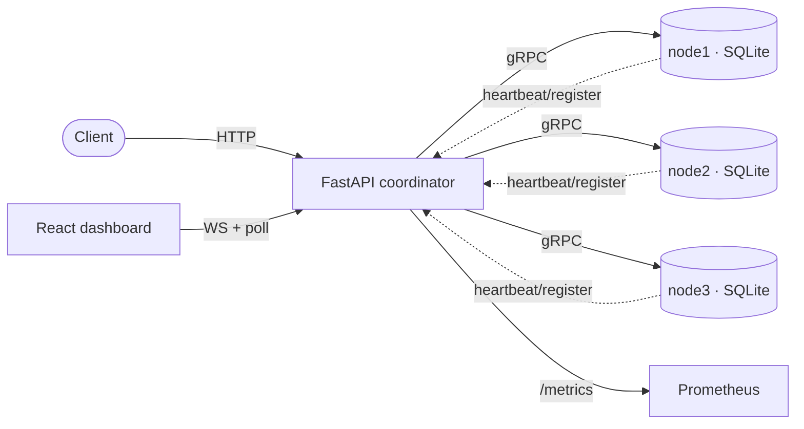
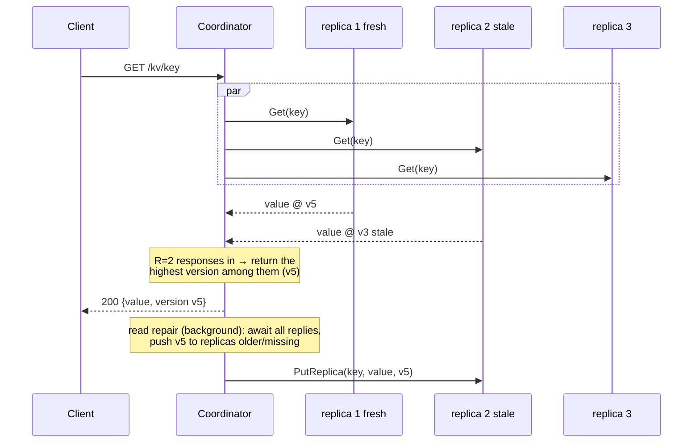
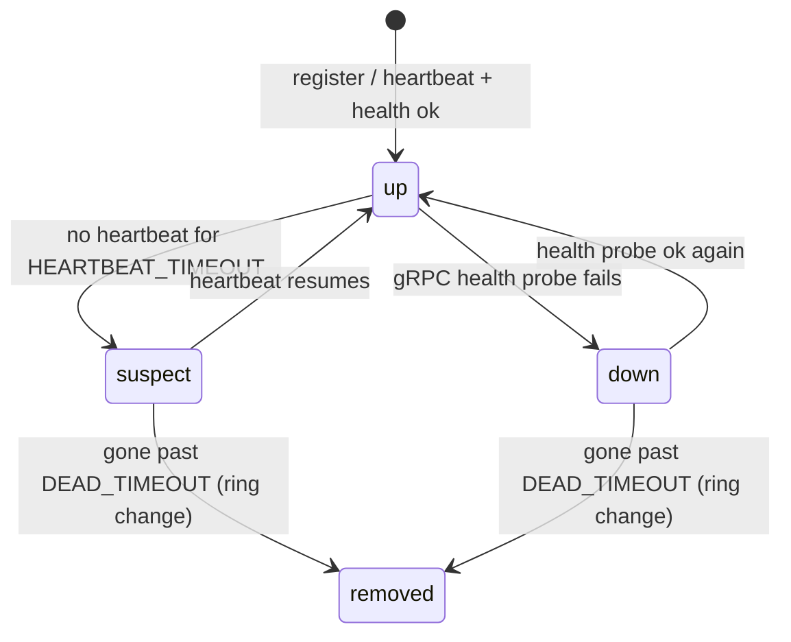
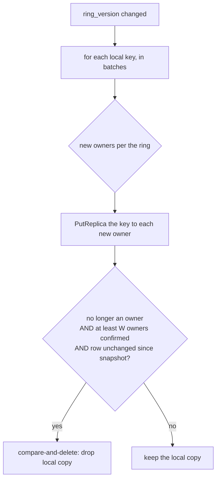

# DistroCache architecture

DistroCache is a Dynamo-style distributed key-value cache: a FastAPI **coordinator** routes every
request through a consistent-hash ring to gRPC **storage nodes**, each owning its own SQLite file.
This document walks the request lifecycles and the mechanisms behind them. Design records with the
rationale and trade-offs live in [docs/design/](design/).

## Components



- The **coordinator** owns the hash ring, mints write versions (HLC), fans requests out to
  replicas, enforces quorums, and runs read repair and the health/membership loops. It holds no
  key data — it is stateless with respect to the cache.
- Each **node** is a gRPC server over a SQLite table (WAL mode). A node is a *cache*, not the store
  of record: on a schema change it drops and refills from replicas.
- `distrocache_common/` holds the hash ring, the gRPC client pool, the HLC, and the generated
  protobuf stubs shared by both sides.

## Consistent hashing and the preference list

Keys map to nodes with a consistent-hash ring (`ConsistentHashRing`), using virtual nodes so
ownership is even and a membership change moves as few keys as possible. A key's **preference
list** is the first `N` (`REPLICATION_FACTOR`) distinct nodes clockwise from its hash — the
replicas that own it. The preference list is computed from **ring membership**, independent of
liveness, so a node being briefly down does not move any key.

## HLC versioning

Every write is stamped by the coordinator with a **Hybrid Logical Clock** version — the tuple
`(physical_ms, logical, coordinator_id)`:

- `physical_ms` tracks wall-clock milliseconds;
- `logical` increments for writes that land in the same millisecond, keeping versions strictly
  increasing under coarse clock resolution or bursts;
- `coordinator_id` is a final, stable tie-break.

Because a single coordinator serializes `clock.tick()`, every write gets a unique, monotonically
increasing version with no clock sync between nodes. Everything compares these tuples:
**last-writer-wins** is "highest version wins." See [0003](design/0003-versions-and-ttl.md).

## Quorums (N, R, W)

`N` replicas per key; a read needs `R` responses, a write needs `W` acks. With **R + W > N** the
read and write quorums always overlap by at least one replica, so a read sees the latest
acknowledged write (read-your-writes). The default is `N=3, R=2, W=2`. The coordinator fans out in
parallel and returns as soon as the quorum-th reply lands, so latency is bounded by the quorum-th
fastest replica, not the slowest. See [0004](design/0004-quorums.md).

## PUT lifecycle

```mermaid
sequenceDiagram
  participant C as Client
  participant Co as Coordinator
  participant R1 as replica 1
  participant R2 as replica 2
  participant R3 as replica 3 DOWN
  C->>Co: POST /kv/key {value, ttl?}
  Note over Co: version = clock.tick()<br/>expires_at = now + ttl
  Co->>Co: live_and_down(preference list)
  par fan out to live replicas
    Co->>R1: Put(key, value, version, expires_at)
    Co->>R2: Put(key, value, version, expires_at)
  and down replica
    Note over Co,R3: R3 is a failed vote immediately<br/>(no gRPC timeout spent)
  end
  R1-->>Co: APPLIED
  R2-->>Co: APPLIED
  Note over Co: W=2 acks reached → respond;<br/>any remaining votes finish in background
  Co-->>C: 200 {replicas, acks, version}
```

A node applies the write only if `version > stored` (last-writer-wins), so a retry that resends the
same version is idempotent (it returns `ALREADY_CURRENT`, still counted as an ack). Below `W` acks
the coordinator returns **503** with the ack count and errors. The TTL is an absolute `expires_at`
computed once and shipped to every replica, so all replicas expire a key at the same instant.

## GET lifecycle (with read repair)



The coordinator returns the highest version among the first `R` responses. A **404** means every
responder missed the key *or* the winning version is a tombstone. A **503** means fewer than `R`
replicas responded. After quorum, **read repair** runs detached: it awaits *all* vote replies
(even late ones, which may be newer than the quorum winner), takes the max, and pushes it to every
replica that answered older or missed. See [0006](design/0006-read-repair.md).

## DELETE lifecycle (tombstones)

A delete is **not** a row removal — it writes a **tombstone**: an empty-value row with a new
(higher) version and `tombstone=1`. The tombstone wins last-writer-wins, so a replica that missed
the delete cannot resurrect the value on a later read or rebalance. A `Get` returns `found=False,
tombstone=True` with the version, and the coordinator treats a winning tombstone as a 404. A
tombstone is garbage-collected only after `TOMBSTONE_GC_SECONDS` past its deletion (never on a
read, never by `MAX_ITEMS` eviction), long enough to outlast any replica that might still hold the
old value. See [0005](design/0005-tombstones.md).

## Membership: ring vs liveness



The coordinator keeps two things apart:

- **Ring membership** — which addresses are in the hash ring. `ring_version` bumps only on
  register, deregister, or a `DEAD_TIMEOUT` prune. Only a ring change rebalances keys.
- **Liveness** — `up` / `suspect` / `down`, from heartbeat age and gRPC health probes. A short
  outage changes liveness but **not** the ring, so the cluster does not reshuffle over a blip.

On the request path, a node currently seen as `down` is counted as a failed vote immediately, so a
request never burns a gRPC timeout on a known-dead node; the quorum threshold stays
`min(quorum, len(preference_list))`, so the R/W overlap still holds. Records are keyed by **address**
(the ring's stable identity), so a re-registering node — or a seed replaced by a real registration —
never creates a second record for one ring slot. See
[0007](design/0007-membership-and-safe-rebalance.md).

## Rebalance: safe compare-and-delete hand-off

When the ring changes (a node joins or is pruned), each node, on seeing the new `ring_version` in
its heartbeat loop, rebalances in batches:



A node drops its local copy only when (a) it is no longer an owner, (b) at least `W` new owners
confirmed the key, and (c) `delete_if_version` shows the row unchanged since the snapshot
(**compare-and-delete**). A write that landed mid-rebalance bumped the version, so the delete is a
no-op and the newer write survives. Over-replication is safe; losing a write is not.

## What is and isn't guaranteed

With `R + W > N`, DistroCache gives **read-your-writes for acknowledged writes** and
last-writer-wins convergence — *not* linearizability and not strict serializability. The single
coordinator is a SPOF and the sole HLC authority; post-quorum replication and rebalance pushes are
best-effort (no background anti-entropy), so full convergence leans on a later read repair or
rebalance. These limits and the reasoning behind each choice are in the design records and the
[README](../README.md#guarantees).
